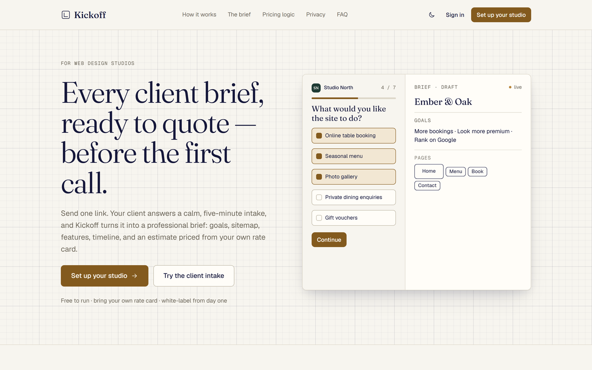
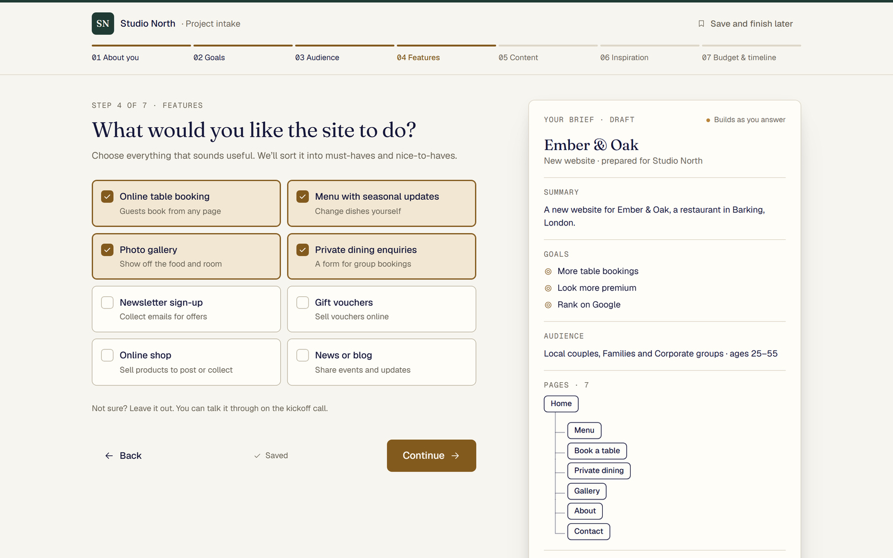
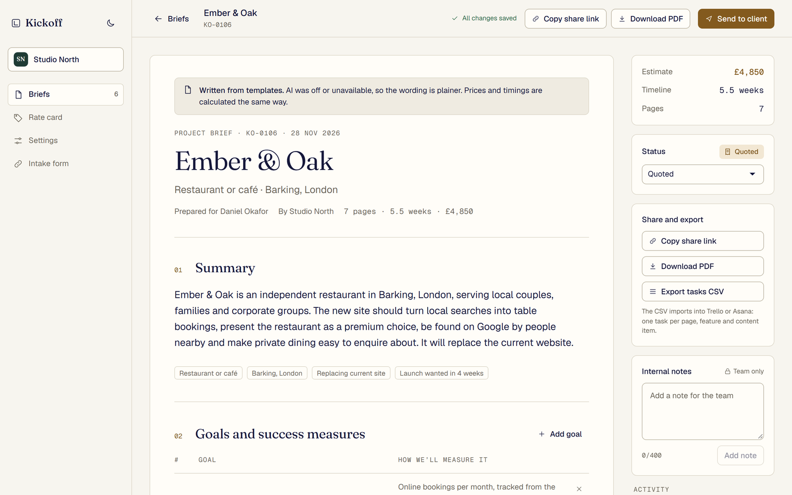
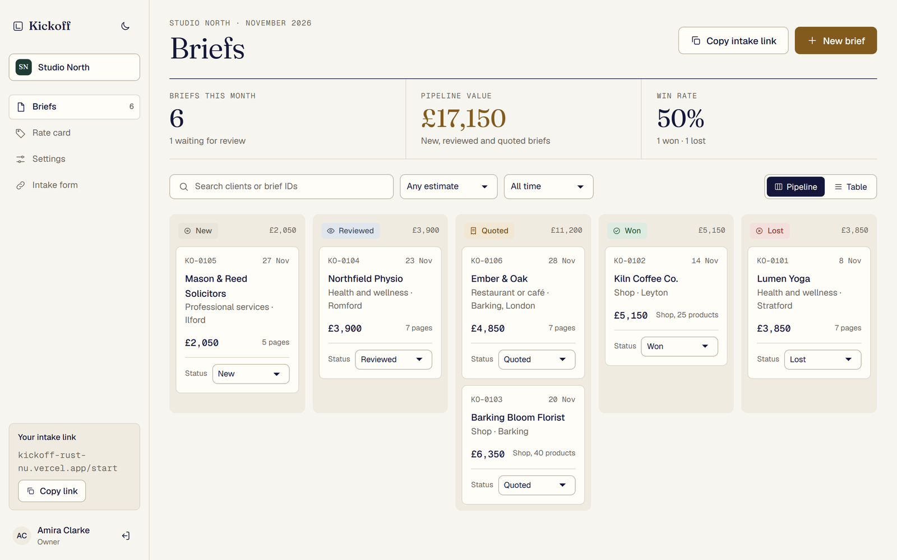
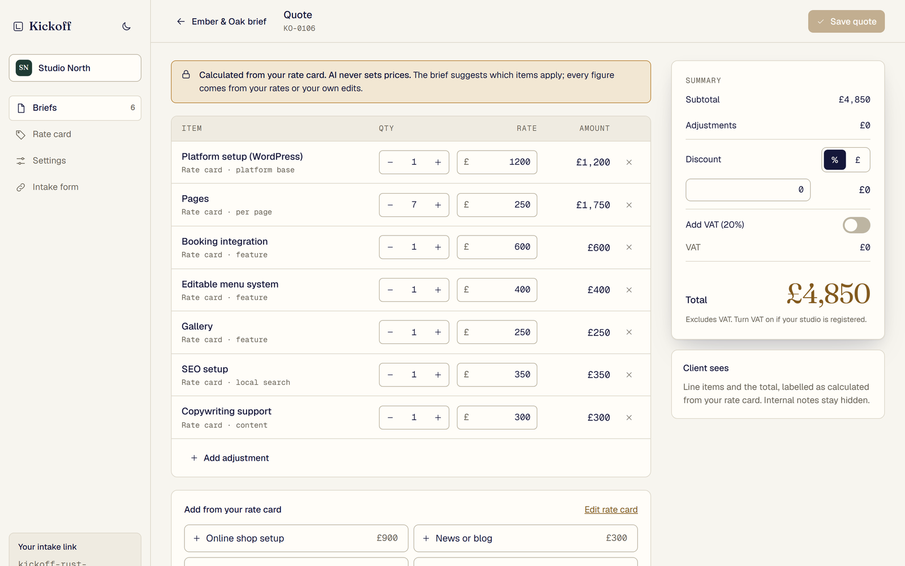
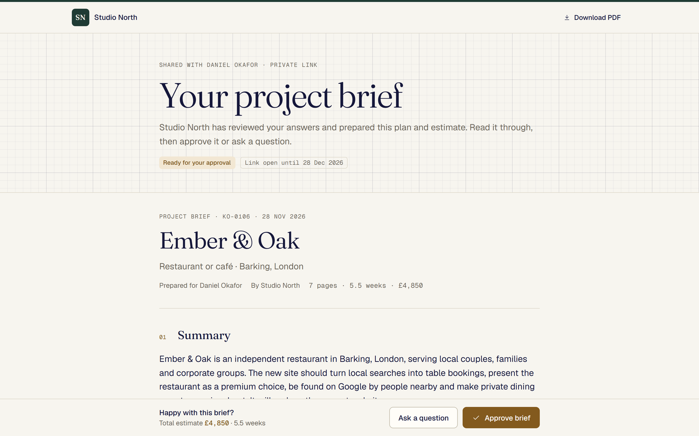
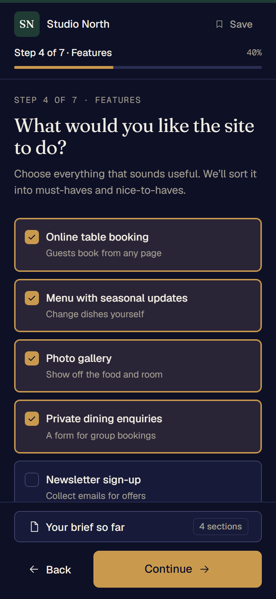

# Kickoff

**Every client brief, ready to quote — before the first call.**

Kickoff is a tool for web design studios. A prospective client fills in a calm, guided intake that
takes about five minutes. As they answer, a project brief builds itself beside the form. When they
submit, the studio gets a complete, editable brief: summary, goals, audience profiles, a recommended
sitemap, Must/Should/Could features, platform, content checklist, timeline, an estimate priced from
the studio's own rate card, risks, and questions for the kickoff call. The studio reviews it, then
sends the client a branded PDF and a private link they can approve, and exports tasks to Trello or
Asana.

**Live demo:** [kickoff-rust-nu.vercel.app](https://kickoff-rust-nu.vercel.app) ·
**Try the client intake:** [/start](https://kickoff-rust-nu.vercel.app/start) ·
**A shared brief:** [Ember & Oak](https://kickoff-rust-nu.vercel.app/share/F5E6uTQCqXL3VTmJvch8ND53mJKMf8R1OabWJAfF28Y)
([PDF](https://kickoff-rust-nu.vercel.app/api/share/F5E6uTQCqXL3VTmJvch8ND53mJKMf8R1OabWJAfF28Y/pdf))



## Screens

|                                                                           |                                                                   |
| ------------------------------------------------------------------------- | ----------------------------------------------------------------- |
|          |                         |
| **Client intake.** One question at a time; the brief assembles alongside. | **Brief editor.** Edit the sitemap, features, timeline and quote. |
|                                    |                             |
| **Dashboard.** Pipeline by status, metrics, search and filters.           | **Quote editor.** Lines from the rate card, discount and VAT.     |
|                               |  |
| **Shared view.** Read-only, branded, with Approve brief.                  | **Mobile and dark.** Tuned separately, never inverted.            |

## The rules decide, the AI only words

Prices, the timeline, the page count, the platform choice and the risks all come from deterministic
rules and the studio's rate card ([`src/lib/engine`](src/lib/engine)). Gemini, when enabled, may
write only the summary, the audience profiles and the wording of follow-up questions. Its replies are
schema-validated, and any figure in the text must match a calculated or client-given number;
otherwise the template text is used. With AI switched off, every brief is written from templates and
nothing else changes.

The Ember & Oak sample is a known-answer test: **£4,850, 5.5 weeks, 7 pages**
([`generate.test.ts`](src/lib/engine/generate.test.ts)).

## Stack

All on free tiers, no credit card:

- **Next.js 16** (App Router) and TypeScript on **Vercel Hobby**
- **Vercel Blob** (private) for briefs, settings, drafts and logo uploads, with a local folder in development
- **Gemini** free tier for prose only, with a template fallback and an on/off setting
- **pdf-lib** for the A4 PDF brief (no headless browser), plus a print stylesheet
- **Resend** free plan for optional email
- **Zod** for every boundary; **Vitest** for unit tests; **Playwright** and **axe-core** for smoke, accessibility and responsive checks

## Design

The interface follows the approved "studio dossier" design: warm ivory paper and deep ink, one
tuned brass accent (4.5:1 on both themes), Fraunces, Geist and Geist Mono, hairlines, and blueprint
lines for the sitemap, timeline and empty states. Motion uses one easing curve and three durations,
animates only transform and opacity, and stops completely with `prefers-reduced-motion`. A living
reference is at `/design-system`.

## Accessibility and security

- WCAG 2.2 AA: labelled inputs, errors announced in text, visible brass focus rings, 24px+ targets,
  full keyboard use (including moving features between priorities and reordering the sitemap).
- `npm run audit <url> <paths…>` runs axe in light and dark and checks for horizontal scroll at 360,
  768, 1024, 1280 and 1440px.
- One owner account per studio: scrypt password hashes, HMAC-signed httpOnly session cookies, and a
  setup code so nobody else can claim a fresh deployment.
- Share links are 256-bit random tokens, stored only as hashes, that expire. Intake drafts autosave
  under unguessable ids. Strict CSP and security headers; private routes are noindex and no-store.

## Run it locally

```bash
npm install
npm run dev          # http://localhost:3000, data saved in ./storage
```

Open `/setup` to create the studio owner, then `/start` to try the client intake. Use **Load sample
briefs** on the empty dashboard, or `npm run seed`, for the sample pipeline. Copy `.env.example` to
`.env.local` to enable Gemini or Resend.

| Script                               | What it does                                             |
| ------------------------------------ | -------------------------------------------------------- |
| `npm test`                           | Unit tests, including the rules engine known answers     |
| `npm run lint` / `npm run typecheck` | ESLint and TypeScript                                    |
| `npm run build`                      | Production build                                         |
| `npm run audit <url> <paths…>`       | Accessibility and responsive audit against a running app |
| `npm run seed`                       | Load the sample briefs into the configured store         |

## Deploy

See [docs/DEPLOYMENT.md](docs/DEPLOYMENT.md): import the repo into Vercel, connect a private Blob
store, set `SESSION_SECRET`, `SETUP_CODE` and `APP_URL`, deploy, and open `/setup`.

## Project layout

```
src/
  app/            routes: landing, intake (/start), workspace (/briefs, /settings), share view, API
  components/     design-system UI, intake, brief document, dashboard, settings, landing
  lib/
    domain/       schemas, vocabulary, the Ember & Oak fixture
    engine/       pricing, sitemap, features, timeline, risks, follow-ups, templates
    ai/           Gemini client and the figure-checked writer
    store/        Blob, file and memory stores
    repo/         settings, briefs, drafts, share links
    pdf/ export/  PDF brief and tasks CSV
    auth/ server/ security/   sessions, request context, rate limits, headers
```

## Licence

MIT
